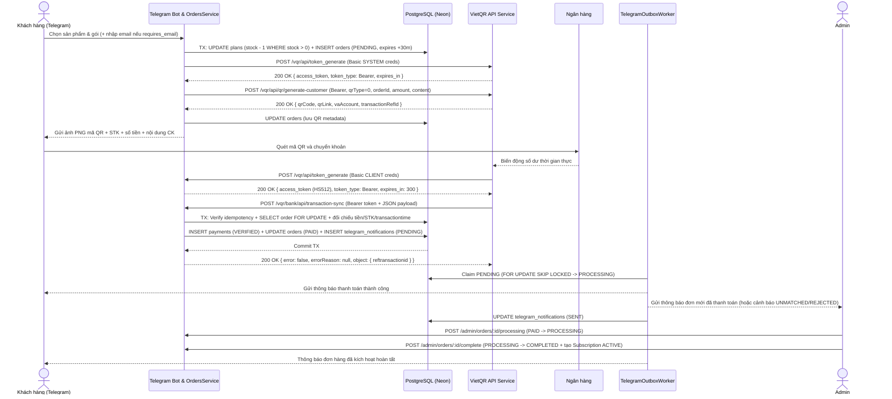

# Hướng dẫn Tích hợp & Vận hành VietQR API Service (VietQR Tingo)

Tài liệu này mô tả đầy đủ kiến trúc, API contract chính thức, cấu hình biến môi trường, quy trình kiểm thử, triển khai và chuyển đổi từ **UAT** sang **Production** cho hệ thống `GeminiService_bot`.

> **Lưu ý trạng thái nghiệm thu:** Tài liệu và source code đã triển khai đầy đủ theo tài liệu chính thức của VietQR (`api.vietqr.vn` / `api-v2.vietqr.vn`). Việc kiểm thử end-to-end thực tế với VietQR Sandbox/Production chỉ hoàn tất sau khi điền đầy đủ credentials thực tế được VietQR Tingo cấp và kiểm tra callback trực tiếp.

---

## 1. Kiến trúc tích hợp

Hệ thống tích hợp VietQR theo mô hình **2 chiều (Outbound + Inbound)** kết hợp **Atomic Stock Reservation** và **Transactional Outbox (at-least-once delivery)**:

- **Tầng cấu hình (`src/config/vietqr.config.ts`):** Tách biệt nghiêm ngặt môi trường `uat` và `production`, chặn cross-wiring (`production` không được trỏ `dev.vietqr.org`, `uat` không được trỏ `api.vietqr.org`), bắt buộc HTTPS và secret tối thiểu 32 ký tự khi `VIETQR_ENABLED=true`.
- **Tầng Inbound Auth (`POST /vqr/api/token_generate`):** Xác thực Basic Auth bằng constant-time `timingSafeEqual` (SHA-256), ký JWT `HS512` qua thư viện `jsonwebtoken` kèm claim `env` (`uat` | `production`) để chống dùng chéo token giữa 2 môi trường.
- **Tầng Inbound Callback (`POST /vqr/bank/api/transaction-sync`):** Xác thực Bearer JWT, validate payload chặt chẽ, parse số tiền bằng `BigInt` (không dùng floating-point), đối soát giao dịch trong 1 PostgreSQL transaction với `SELECT ... FOR UPDATE` và `UNIQUE (provider, provider_transaction_id)` + partial unique index `payments_order_verified_unique_idx`.
- **Tầng Stock Reservation (`OrdersService` & `OrderExpirationService`):**
  - Tạo đơn `PENDING` -> giữ nguyên tử 1 slot tồn kho (`stock_quantity > 0` + PostgreSQL `CHECK (stock_quantity >= 0)`).
  - Hủy đơn / quá hạn 30 phút -> hoàn trả slot đúng 1 lần (khóa dòng + `stock_released_at IS NULL`).
  - Thanh toán thành công -> dùng slot đã giữ (không trừ kho lần 2), cập nhật `orders.status = PAID`.
  - Webhook đến muộn nhưng `transactiontime <= expires_at` -> thử giữ lại tồn kho nguyên tử; nếu hết hàng vẫn lưu giao dịch nhận tiền (`REJECTED / OUT_OF_STOCK_AFTER_LATE_WEBHOOK`) để Admin xử lý thủ công, không tự giao hàng.
- **Tầng Durable Transactional Outbox (`TelegramOutboxService`):** Ghi thông báo khách hàng và Admin vào `public.telegram_notifications` trong cùng DB transaction, sau đó worker đọc bằng `SELECT ... FOR UPDATE SKIP LOCKED` ở ngoài transaction để gửi Telegram với Exponential Backoff, tôn trọng `retry_after` (HTTP 429) và tự khôi phục bản ghi `PROCESSING` bị treo sau khi server restart.
  - *Đảm bảo gửi lại:* **at-least-once** (Telegram Bot API không hỗ trợ idempotency key ở mức tin nhắn).
- **Tầng Admin Fulfillment (`AdminOrdersController`):** Thanh toán chỉ đưa đơn tới `PAID` (không tự động tạo `Subscription` hay `COMPLETED`). Admin tiếp nhận `PAID -> PROCESSING -> COMPLETED`; khi hoàn tất gói có `duration_days > 0`, hệ thống tạo 1 bản ghi `subscriptions` (`ACTIVE`, `UNIQUE(order_id)`) tính hạn sử dụng từ thời điểm kích hoạt thực tế.

---

## 2. Sequence Diagram — Luồng đặt hàng, thanh toán & kích hoạt



---

## 3. Danh sách API Endpoints

### 3.1. Inbound APIs (VietQR gọi sang Backend của bạn)

| Method | Path | Xác thực | Mô tả |
|---|---|---|---|
| `POST` | `/vqr/api/token_generate` | `Authorization: Basic Base64(client_username:client_password)` | Cấp Bearer JWT (`HS512`) cho VietQR |
| `POST` | `/vqr/bank/api/transaction-sync` | `Authorization: Bearer <access_token>` | Tiếp nhận biến động số dư và đối chiếu đơn hàng |

> **Phân biệt quan trọng:** `POST https://dev.vietqr.org/vqr/bank/api/test/transaction-callback` là endpoint **phía VietQR Sandbox** để bạn gọi giả lập giao dịch thử nghiệm; VietQR sẽ bắn callback thật về `POST https://<PUBLIC_DOMAIN>/vqr/bank/api/transaction-sync` của bạn. Không dùng endpoint giả lập UAT cho Production.

### 3.2. Outbound APIs (Backend gọi sang VietQR)

| Method | URL (UAT) | URL (Production) | Mô tả |
|---|---|---|---|
| `POST` | `https://dev.vietqr.org/vqr/api/token_generate` | `https://api.vietqr.org/vqr/api/token_generate` | Lấy system Bearer token từ VietQR |
| `POST` | `https://dev.vietqr.org/vqr/api/qr/generate-customer` | `https://api.vietqr.org/vqr/api/qr/generate-customer` | Sinh mã VietQR thanh toán cho đơn hàng |

### 3.3. Admin APIs (Localhost-only Basic Auth qua `AdminGuard`)

| Method | Path | Mô tả |
|---|---|---|
| `GET` | `/admin/orders?status=PAID` | Danh sách đơn hàng theo trạng thái |
| `GET` | `/admin/payments/exceptions` | Danh sách giao dịch `UNMATCHED` và `REJECTED` cần đối soát thủ công |
| `POST` | `/admin/orders/:id/processing` | Chuyển đơn `PAID -> PROCESSING` |
| `POST` | `/admin/orders/:id/complete` | Chuyển đơn `PAID`/`PROCESSING -> COMPLETED`, tạo `Subscription` `ACTIVE` (nếu `duration_days > 0`) |

---

## 4. Request & Response Examples

### 4.1. `POST /vqr/api/token_generate`

**Request:**
```http
POST /vqr/api/token_generate HTTP/1.1
Host: <YOUR_DOMAIN>
Content-Type: application/json
Authorization: Basic <BASE64_CLIENT_USERNAME_COLON_PASSWORD>
```

**Response `200 OK`:**
```json
{
  "access_token": "<JWT_HS512_TOKEN>",
  "token_type": "Bearer",
  "expires_in": 300
}
```

**Response `400 Bad Request` (thiếu/sai định dạng header) hoặc `401 Unauthorized` (sai credentials):**
```json
{
  "status": "FAILED",
  "message": "Invalid credentials"
}
```

### 4.2. `POST /vqr/bank/api/transaction-sync`

**Request:**
```http
POST /vqr/bank/api/transaction-sync HTTP/1.1
Host: <YOUR_DOMAIN>
Content-Type: application/json
Authorization: Bearer <ACCESS_TOKEN_FROM_TOKEN_GENERATE>
```

```json
{
  "bankaccount": "<RECEIVING_BANK_ACCOUNT>",
  "amount": 100000,
  "transType": "C",
  "content": "<ORDER_CODE>",
  "transactionid": "<VIETQR_TRANSACTION_UUID>",
  "transactiontime": 1757342061000,
  "referencenumber": "<BANK_REFERENCE_CODE>",
  "orderId": "<ORDER_CODE>",
  "terminalCode": "",
  "subTerminalCode": "",
  "serviceCode": "",
  "urlLink": "",
  "sign": ""
}
```

**Response `200 OK` (Thành công / Idempotent duplicate / Đã ghi nhận giao dịch ngoại lệ để tránh retry vô ích):**
```json
{
  "error": false,
  "errorReason": null,
  "toastMessage": "Transaction processed successfully",
  "object": {
    "reftransactionid": "<INTERNAL_PAYMENT_UUID>"
  }
}
```

**Response `401 Unauthorized` (Thiếu hoặc sai/hết hạn token):**
```json
{
  "error": true,
  "errorReason": "INVALID_TOKEN",
  "toastMessage": "Invalid or expired token",
  "object": null
}
```

**Response `400 Bad Request` (Sai/thiếu trường bắt buộc hoặc số tiền không nguyên):**
```json
{
  "error": true,
  "errorReason": "INVALID_PAYLOAD",
  "toastMessage": "Field \"amount\" must be a positive integer",
  "object": null
}
```

**Response `500 Internal Server Error` (Lỗi hệ thống/DB tạm thời -> kích hoạt cơ chế retry 10 lần/5 phút của VietQR):**
```json
{
  "error": true,
  "errorReason": "TRANSACTION_FAILED",
  "toastMessage": "Internal processing error",
  "object": null
}
```

---

## 5. Danh sách biến môi trường

Xem template chuẩn trong [.env.example](file:///d:/GeminiService_bot/.env.example):

| Biến môi trường | Bắt buộc | Mô tả |
|---|---|---|
| `DATABASE_URL` | Có | PostgreSQL connection string (`sslmode=require`) |
| `PORT` | Không (mặc định `3000`) | Cổng HTTP của NestJS |
| `TELEGRAM_BOT_TOKEN` | Có | Token của Telegram Bot |
| `TELEGRAM_EMOJI_OWNER_ID` | Không | Telegram user ID dùng khi sync custom emoji |
| `TELEGRAM_ADMIN_CHAT_ID` | Khuyến nghị | Chat ID / Group ID của Admin nhận thông báo đơn mới `PAID` và cảnh báo `UNMATCHED`/`REJECTED` |
| `VIETQR_ENABLED` | Có (`true`/`false`) | Bật/tắt module VietQR |
| `VIETQR_ENV` | Có (`uat`/`production`) | Phân tách môi trường UAT và Production |
| `VIETQR_MERCHANT_NAME` | Không | Tên định danh merchant |
| `VIETQR_CLIENT_USERNAME` | Có khi bật VietQR | Username do bạn tạo để VietQR gọi vào `/vqr/api/token_generate` |
| `VIETQR_CLIENT_PASSWORD` | Có khi bật VietQR | Password mạnh do bạn tạo cho VietQR gọi vào `/vqr/api/token_generate` |
| `VIETQR_TOKEN_SECRET` | Có khi bật VietQR | Chuỗi bí mật tối thiểu 32 ký tự để ký JWT `HS512` (khác nhau giữa UAT và Production) |
| `VIETQR_TOKEN_EXPIRES_IN` | Không (mặc định `300`) | Thời hạn access token (giây, `60..86400`) |
| `VIETQR_BASE_URL` | Có | UAT: `https://dev.vietqr.org` \| Production: `https://api.vietqr.org` |
| `VIETQR_SYSTEM_USERNAME` | Có để tạo QR | Username do VietQR cấp |
| `VIETQR_SYSTEM_PASSWORD` | Có để tạo QR | Password do VietQR cấp |
| `VIETQR_QR_TYPE` | Không (mặc định `0`) | `0` (VietQR động), `1` (tĩnh), `3` (bán động) |
| `VIETQR_BANK_CODE` | Có để tạo QR | Mã ngân hàng thụ hưởng (VD: `MB`, `VCB`, `TCB`...) |
| `VIETQR_BANK_ACCOUNT` | Có để tạo QR & đối soát | Số tài khoản ngân hàng đã liên kết VietQR |
| `VIETQR_ACCOUNT_NAME` | Có để tạo QR | Tên chủ tài khoản (VIET HOA KHONG DAU) |
| `VIETQR_TERMINAL_CODE` | Tùy chọn | Bắt buộc nếu dùng `qrType = 1` hoặc `3` |
| `ORDER_EXPIRES_MINUTES` | Không (mặc định `30`) | Thời hạn thanh toán đơn hàng (phút) |

---

## 6. Kiểm thử bằng cURL / Postman

### 6.1. Kiểm thử API Get Token của backend
```bash
curl --location --request POST "https://<YOUR_PUBLIC_DOMAIN>/vqr/api/token_generate" \
  --header "Content-Type: application/json" \
  --header "Authorization: Basic $(printf '%s:%s' '<VIETQR_CLIENT_USERNAME>' '<VIETQR_CLIENT_PASSWORD>' | base64)"
```

### 6.2. Kiểm thử API Transaction Sync của backend
```bash
curl --location --request POST "https://<YOUR_PUBLIC_DOMAIN>/vqr/bank/api/transaction-sync" \
  --header "Content-Type: application/json" \
  --header "Authorization: Bearer <ACCESS_TOKEN>" \
  --data '{
    "bankaccount": "<VIETQR_BANK_ACCOUNT>",
    "amount": 100000,
    "transType": "C",
    "content": "<ORDER_CODE>",
    "transactionid": "<UNIQUE_TEST_UUID>",
    "transactiontime": 1763890000000,
    "referencenumber": "<BANK_REF_CODE>",
    "orderId": "<ORDER_CODE>"
  }'
```

### 6.3. Gọi API giả lập giao dịch trên VietQR Sandbox (chỉ môi trường UAT)
1. Lấy system token từ `POST https://dev.vietqr.org/vqr/api/token_generate` (Basic Auth bằng `VIETQR_SYSTEM_USERNAME:VIETQR_SYSTEM_PASSWORD`).
2. Gọi giả lập callback sang VietQR Sandbox để VietQR bắn webhook thật về backend của bạn:
```bash
curl --location --request POST "https://dev.vietqr.org/vqr/bank/api/test/transaction-callback" \
  --header "Content-Type: application/json" \
  --header "Authorization: Bearer <VIETQR_SANDBOX_SYSTEM_TOKEN>" \
  --data '{
    "bankAccount": "<VIETQR_BANK_ACCOUNT>",
    "content": "<ORDER_CODE_FROM_QR_RESPONSE>",
    "amount": 100000,
    "transType": "C",
    "bankCode": "<VIETQR_BANK_CODE>"
  }'
```

---

## 7. Hướng dẫn Deploy Backend

1. Chuẩn bị server Linux / PaaS có domain công khai và chứng chỉ **HTTPS TLS hợp lệ** (reverse proxy bằng Nginx hoặc Caddy trỏ về `http://127.0.0.1:3000`).
2. Cấu hình biến môi trường `.env` bảo mật trên server (không commit `.env` lên Git).
3. Chạy migration an toàn và build production:
   ```bash
   npm ci
   npx prisma migrate deploy
   npm run build
   npm run start:prod
   ```
4. Bảo vệ `/admin/*`: `AdminGuard` chỉ cho phép kết nối từ loopback (`127.0.0.1` / `::1`) kèm Basic Auth; **không** expose `/admin/*` ra internet công khai trên Nginx/Caddy.
5. Đảm bảo tường lửa không chặn dải IP outbound của VietQR khi VietQR gọi `/vqr/api/token_generate` và `/vqr/bank/api/transaction-sync`.

---

## 8. Bảng giá trị khai báo trên màn hình API Service của VietQR Tingo

Nhập chính xác các giá trị tương ứng từ cấu hình thực tế của bạn (không dùng credentials mẫu hoặc giả):

| Trường cấu hình | Giá trị cần nhập |
|---|---|
| Tên Merchant | `<VIETQR_MERCHANT_NAME>` (tên định danh cửa hàng của bạn) |
| Kiểu địa chỉ | `URL` |
| URL kết nối | `https://<YOUR_PUBLIC_DOMAIN>` (HTTPS public URL của backend, không có dấu `/` cuối) |
| URL Path | `vqr` |
| Username khách hàng | `<VIETQR_CLIENT_USERNAME>` (giá trị trùng khớp `.env` trên backend) |
| Password khách hàng | `<VIETQR_CLIENT_PASSWORD>` (mật khẩu mạnh trùng khớp `.env` trên backend) |
| Get Token URL | `https://<YOUR_PUBLIC_DOMAIN>/vqr/api/token_generate` |
| Callback URL | `https://<YOUR_PUBLIC_DOMAIN>/vqr/bank/api/transaction-sync` |

> **Lưu ý về cấu hình `plans.requires_email`:** Với các gói sản phẩm cần thu thập email khách hàng trước khi tạo đơn, Admin cập nhật `UPDATE public.plans SET requires_email = TRUE WHERE code IN (...);`.

---

## 9. Hướng dẫn chuyển đổi từ UAT sang Production (Go-Live)

1. Hoàn tất toàn bộ test case UAT trên `dev.vietqr.org` (tạo QR động `qrType = 0`, Test Callback thành công, thử duplicate/retry, sai số tiền, quá hạn, hủy đơn).
2. Xác nhận với đội kỹ thuật VietQR trước Go-Live:
   - Tài khoản Production đã được cấp quyền `qrType = 0` (hoặc cập nhật `VIETQR_QR_TYPE` tương ứng).
   - Có yêu cầu xác minh chữ ký `sign` bổ sung hay không; nếu có, phải xác nhận chính xác thuật toán và triển khai trước khi mở Production.
   - Bộ mã lỗi retry (HTTP 5xx vs HTTP 200) khớp cấu hình phía VietQR.
3. Tạo bộ credentials **hoàn toàn mới và tách biệt** cho Production:
   - Đặt `VIETQR_ENV=production`
   - Đặt `VIETQR_BASE_URL=https://api.vietqr.org`
   - Sinh mới `VIETQR_CLIENT_USERNAME`, `VIETQR_CLIENT_PASSWORD`, `VIETQR_TOKEN_SECRET` (>= 32 ký tự ngẫu nhiên, khác UAT)
   - Điền `VIETQR_SYSTEM_USERNAME`, `VIETQR_SYSTEM_PASSWORD`, `VIETQR_BANK_CODE`, `VIETQR_BANK_ACCOUNT`, `VIETQR_ACCOUNT_NAME` của môi trường Production
   - Khai báo URL & credentials Production trên portal VietQR Production (`pro.vietqr.vn`).
4. Khởi động lại service, thực hiện 1 giao dịch thật giá trị nhỏ để kiểm tra end-to-end: tạo QR -> chuyển khoản -> nhận callback `200 OK` -> đơn chuyển `PAID` -> nhận thông báo Telegram cho Khách & Admin -> Admin xử lý `PROCESSING -> COMPLETED` -> tạo `Subscription` `ACTIVE`.
